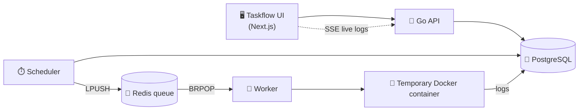
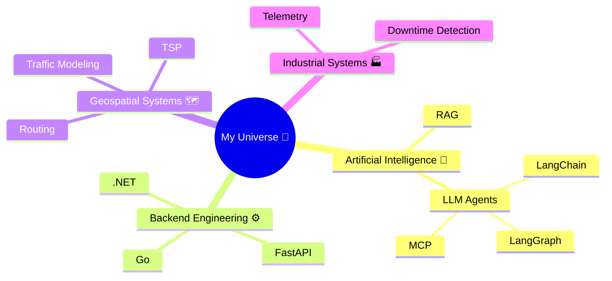

<p align="center">
  
</p>

<p align="center">
  
  <a href="mailto:shamsiamirhossein1@gmail.com"></a>
  <a href="https://linkedin.com/in/amirhossein-s-b2b97b38b/"></a>
  <a href="https://amir-hossein-shamsi.github.io/portfolio/"></a>
</p>

---

## 👨‍💻 About Me

```bash
$ whoami
amirhossein-shamsi

$ cat ~/profile.json
{
  "name":     "AmirHossein Shamsi",
  "role":     ["AI Engineer", "Backend Developer"],
  "focus":    ["LLM Agents", "MCP", "Geospatial Systems", "Industrial Telemetry"],
  "building": "AI-powered backends · routing engines · industrial monitoring",
  "tools":    ["Go", "Python", "FastAPI", ".NET", "PyTorch"],
  "motto":    "AI + Backend + Data + Infrastructure = One Reliable System"
}

$ sudo make impact
▸ training models............ done ✓
▸ deploying systems.......... done ✓
▸ solving real problems...... always ✓
```

I build **AI-powered applications, backend services, and intelligent geospatial and industrial systems**. I focus on practical engineering: architecture, implementation, and deployment of systems that work reliably in the real world.

---

## 🚀 Featured Projects

### 🏭 Industrial Machine Monitoring (Go)
A backend system written in Go for monitoring CNC and industrial machines. It ingests telemetry from edge devices, detects machine downtime, and triggers maintenance-related operational events.

### ⚙️ Job Scheduler
An administrator workspace for creating script jobs, scheduling their execution, and inspecting results.



- **Execution:** each run starts a temporary Docker container with memory, CPU, PID, and timeout limits, a read-only filesystem, and no network by default
- **Runtimes:** Python, Node.js, Bash, Go, and SQL jobs against PostgreSQL, MySQL, SQL Server, or Oracle, with AES-256-GCM encrypted database passwords
- **Scheduling:** one-time runs, interval schedules, and cron expressions with IANA timezones
- **Monitoring:** persisted logs, cursor pagination, live SSE streaming with a polling fallback
- **Honest limits:** no retries, dead-letter queue, or stale-run recovery; designed for trusted administrators

**Stack:** `Go` `PostgreSQL 16` `Redis 7` `Docker` `Next.js` `TypeScript` `Tailwind CSS` `Playwright`

### 🧭 MarketLens AI
A Python backend for competitor and market research. Questions move through a LangGraph workflow: Groq models plan the search and synthesize the answer, Tavily retrieves live web results, and the system filters the evidence and stores each report. Answers include source URLs and a confidence score.

**Stack:** `Python` `FastAPI` `LangGraph` `Groq` `Tavily` `PostgreSQL` `Redis` `SQLAlchemy` `Docker Compose`

<!-- MORE PROJECTS: copy this block for each project
### 🔧 Project Name
One or two sentences on what it does and who it's for.

- **Key feature:** detail
- **Key feature:** detail

**Stack:** `Tech` `Tech`
-->

---

## 🧰 Tech Stack

<p align="center">
  
</p>

| Area | Technologies |
|------|--------------|
| 🤖 **AI / LLM** | LangChain · LangGraph · MCP · RAG · OpenAI · Groq · PyTorch · scikit-learn |
| ⚙️ **Backend** | Go · Python · FastAPI · .NET · REST · GraphQL · WebSockets · SSE |
| 🗺️ **Geospatial** | OpenStreetMap · OSRM · OSMnx · GeoPandas · NetworkX · MapLibre |
| 🏭 **Industrial / Real-time** | Telemetry ingestion · event detection · edge devices |
| 🔎 **Data** | PostgreSQL · Redis · Elasticsearch · MongoDB · vector search |
| 🐳 **Infrastructure** | Docker · Compose · Linux · Git · CI/CD |

---

## 🧠 Areas of Interest



---

## 🚀 Currently Exploring

| Focus Area | Progress |
|------------|----------|
| 🤖 Advanced LLM Agents | `█████████░` |
| 🔗 MCP-based Applications | `████████░░` |
| 🕸️ LangGraph Multi-Agent Systems | `████████░░` |
| 🗺️ Intelligent Routing & Optimization | `███████░░░` |
| ⚡ Distributed Backend Systems | `███████░░░` |
| ☸️ Kubernetes & Cloud-Native | `███░░░░░░░` |

<sub>*bars measured in pure enthusiasm, not science 📏😄*</sub>

---

## 💬 Wisdom of the Day

<p align="center">
  
</p>

---

## 📫 Connect With Me

<p align="center">
  <i>“Build intelligent systems.<br>
  Solve real problems.<br>
  Keep the engineering solid.”</i>
</p>


