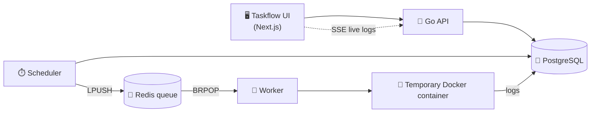
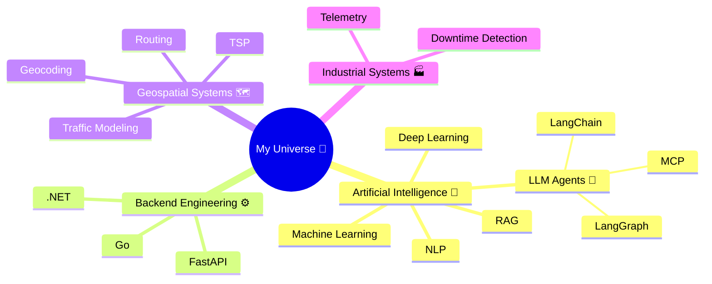

<p align="center">
  
</p>

<p align="center">
  
  <a href="mailto:shamsiamirhossein1@gmail.com"></a>
  <a href="https://linkedin.com/in/amirhossein-s-b2b97b38b/"></a>
  <a href="https://amir-hossein-shamsi.github.io/portfolio/"></a>
</p>

---

## 👨‍💻 About Me

```bash
$ whoami
amirhossein-shamsi

$ cat ~/profile.json
{
  "name":     "AmirHossein Shamsi",
  "role":     ["AI Engineer", "Backend Architect", "LLM Specialist"],
  "focus":    ["LLM Agents", "MCP", "RAG", "Geospatial Systems", "Industrial Telemetry"],
  "building": "AI-powered backends · routing engines · telemetry platforms",
  "tools":    ["Python", "FastAPI", "C# / .NET", "Go", "PyTorch"],
  "motto":    "AI + Backend + Data + Infrastructure = One Reliable System"
}

$ sudo make impact
▸ training models............ done ✓
▸ deploying systems.......... done ✓
▸ solving real problems...... always ✓
```

I build **AI-powered applications, backend services, and intelligent geospatial and industrial systems**. I focus on practical engineering: architecture, implementation, and deployment of systems that work reliably in the real world.

---

## 🚀 Featured Projects

### 🏭 Industrial Machine Monitoring
**Go** · Backend for CNC and industrial machines

A backend system for monitoring CNC and industrial machines. It ingests telemetry from edge devices, detects machine downtime, and triggers maintenance-related operational events.

### ⚙️ Job Scheduler
**Go · PostgreSQL · Redis · Docker · Next.js**

An administrator workspace for creating script jobs, scheduling their execution, and inspecting results.



- **Execution:** a temporary Docker container per run, with memory, CPU, PID, and timeout limits, a read-only filesystem, and no network by default
- **Runtimes:** Python, Node.js, Bash, Go, and SQL jobs against PostgreSQL, MySQL, SQL Server, or Oracle, with AES-256-GCM encrypted credentials
- **Scheduling:** one-time runs, intervals, and cron expressions with IANA timezones
- **Monitoring:** persisted logs, cursor pagination, live SSE streaming with a polling fallback
- **Honest limits:** no retries, dead-letter queue, or stale-run recovery; designed for trusted administrators

### 🧭 MarketLens AI
**Python · FastAPI · LangGraph · Groq · Tavily**

A backend for competitor and market research. Questions move through a LangGraph workflow: Groq models plan the search and synthesize the answer, Tavily retrieves live web results, and the system filters the evidence and stores each report. Answers include source URLs and a confidence score.

### 🛰️ Supply Chain Impact Analysis
**.NET Core · Neo4j · Microservices** · *Enterprise Graph Architecture*

A graph-powered business continuity platform that maps supply chain dependencies, simulates disruption cascades, and helps optimize logistics flow.

- Modeled multi-tier supply chain dependencies in Neo4j
- Implemented risk simulation algorithms in .NET Core
- Event-driven microservices architecture

🔗 [Repository](https://github.com/Amir-Hossein-shamsi/Supply_Chain_Dependency)

### 📍 Real-Time Geo-Tracking Engine
**FastAPI · WebSockets · Redis · Geospatial** · *High-Concurrency Systems*

A geospatial tracking engine built for ultra-low latency. It processes thousands of concurrent telemetry streams for live fleet and package monitoring.

- Scaled WebSocket connections using Redis Pub/Sub
- Asynchronous I/O processing with FastAPI
- Real-time geofencing and spatial queries

🔗 [Repository](https://github.com/Amir-Hossein-shamsi/Real-Time-Geo-Tracking-Application)

### 📮 AddressIntel Engine
**C# · PostGIS · Entity Framework · CQRS** · *Geospatial Data Engineering*

An address standardization and geocoding pipeline that parses, cleans, and validates unstructured location data into precise spatial coordinates.

- Advanced text parsing and normalization
- High-performance spatial indexing with PostGIS
- CQRS pattern for separated read and write workloads

🔗 [Repository](https://github.com/Amir-Hossein-shamsi/AddressIntel)

### 🤖 QuantumLeap GPT
**Python · LangChain · LLMs · Vector DB** · *AI & LLM Orchestration*

An agentic pipeline with dynamic prompt routing and semantic memory. It switches between multiple LLMs to produce context-aware, accurate responses.

- Semantic search and context retrieval (RAG)
- Dynamic routing between GPT-4 and Gemini
- Persistent conversation memory using vector databases

🔗 [Repository](https://github.com/Amir-Hossein-shamsi/quantumleap-gpt)

### ⚡ Smart Energy Analytics
**Django · GraphQL · MongoDB · Docker** · *IoT & Telemetry Analytics*

A scalable energy telemetry platform that aggregates, processes, and analyzes real-time power consumption from distributed smart devices.

- Schema-driven data fetching with GraphQL
- Time-series ingestion and schema-less storage in MongoDB
- Containerized deployment with Docker and automated ingestion pipelines

🔗 [Repository](https://github.com/Amir-Hossein-shamsi/Energy-Analytics)

### 🥗 VitaGuide Nutrition Assistant
**Python · LangChain · RAG · GPT-4o-mini** · *RAG & Bio-Intelligence*

A biomedical RAG assistant that extracts and synthesizes nutritional data from clinical literature to give evidence-based dietary recommendations.

- High-precision semantic retrieval with LangChain
- Domain-adapted inference with GPT-4o-mini
- Automated extraction pipeline for unstructured clinical content

🔗 [Repository](https://github.com/Amir-Hossein-shamsi/vitaguide)

---

## 🧰 Skills

| | Category | Skills |
|---|----------|--------|
| 🧠 | **Machine Learning & AI** | Python *(Expert)* · PyTorch · TensorFlow · LangChain · LLMs & RAG |
| 🐍 | **Python Backend** | FastAPI *(Expert)* · Django · AsyncIO · Flask |
| ⚡ | **.NET Engineering** | C# / .NET 10 *(Expert)* · ASP.NET Core · EF Core · CQRS |
| 🗄️ | **Databases & DevOps** | PostgreSQL & PostGIS · Neo4j · MongoDB · Redis · Docker · WebSockets |

<p align="center">
  
</p>

---

## 🧠 Areas of Interest



---

## 🚀 Currently Exploring

| Focus Area | Progress |
|------------|----------|
| 🤖 Advanced LLM Agents | `█████████░` |
| 🔗 MCP-based Applications | `████████░░` |
| 🕸️ LangGraph Multi-Agent Systems | `████████░░` |
| 🗺️ Intelligent Routing & Optimization | `███████░░░` |
| 🧠 Graph Neural Networks | `█████░░░░░` |
| 🏢 .NET 10 / Enterprise Architecture | `█████░░░░░` |
| ⚡ Distributed Backend Systems | `███████░░░` |
| ☸️ Kubernetes & Cloud-Native | `███░░░░░░░` |

<sub>*bars measured in pure enthusiasm, not science 📏😄*</sub>

---

## 💬 Wisdom of the Day

<p align="center">
  
</p>

---

## 📫 Connect With Me

<p align="center">
  <a href="mailto:shamsiamirhossein1@gmail.com"></a>
  <a href="https://github.com/Amir-Hossein-shamsi"></a>
  <a href="https://linkedin.com/in/amirhossein-s-b2b97b38b/"></a>
  <a href="https://amir-hossein-shamsi.github.io/portfolio/"></a>
</p>

<p align="center">
  <i>“Build intelligent systems.<br>
  Solve real problems.<br>
  Keep the engineering solid.”</i>
</p>


